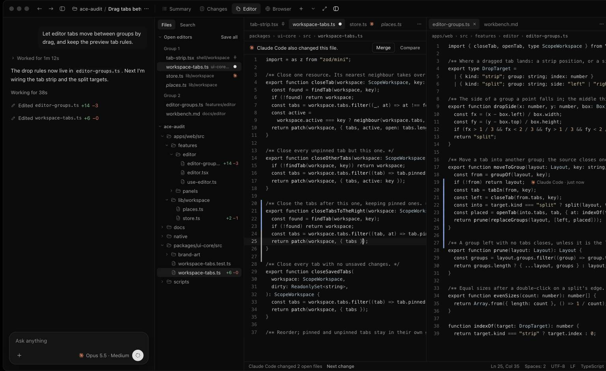
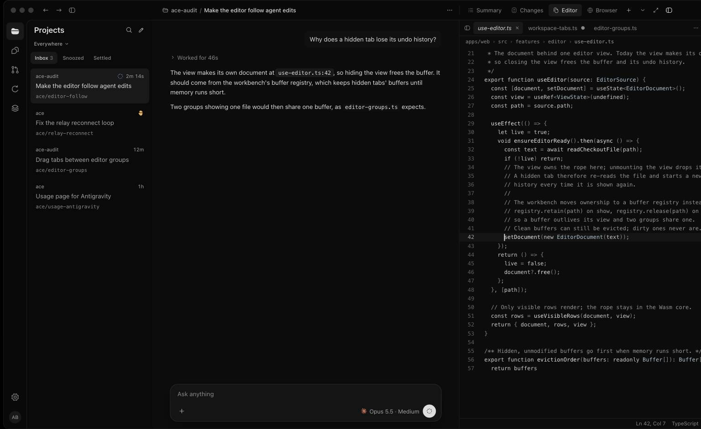

# Editor: the editor workbench

Status: accepted 2026-11-19; the owner settled the open questions (see Decided questions). Decision record:
[ADR 0193](../adr/0193-one-editor-per-thread.md). Mockup:
[workbench-mockup.html](workbench-mockup.html) (screenshots
[1](workbench-mockup-1.jpg), [2](workbench-mockup-2.jpg)). Audit evidence: [audit/](audit/).

## Problem

A person who reads and edits code beside their agents today gets one side-panel tab per file. Each
tab carries its own tree, its own toolbar and its own read-only/edit mode, and shares one strip with
Summary, Changes, Browser and terminals. Three files open and the strip already scrolls them out of
sight. Files open in a panel about 360px wide, so code is clipped and the path collapses to
"… › w…". Editing needs the pencil first, and saving drops back to read-only. Worst, when an agent
writes a file the person is editing, nothing says so until they save, and saving then offers only
to overwrite the agent's work.

The owner wants a real editor: many files open in one editor area with its own tabs, splits and
keyboard flow, the Files explorer still there for quick one-file lookups, and a UX that is better
than today's, not just VS Code parity.

## Solution

Each thread gets **one editor**: a panel tab that holds an explorer (Files and Search),
an editor area of one or more **groups** (each with its own tab strip, breadcrumbs and editors)
and a slim status line. Every way of opening a checkout file opens it there: the explorer, quick
open, a search hit, a mention in the chat, a link in an answer, the Work card. A glance opens a
**preview tab** (italic) that the next glance replaces; a deliberate open keeps it. Beside the chat
the editor is compact (one group, explorer stepped aside), and that compact form is the quick
one-file view: there is no second kind of file view to learn.

Files are always editable. Typing makes a tab unsaved (a dot in its close slot). Agents' edits land
live in open editors, marked with who made them, and an agent that changes a file the person is
editing raises one line with Merge and Compare instead of a silent fork.





## The recommended model, and why

**One editor per thread, in the side panel; every file open goes there; a glance is a preview
tab.**

- **One buffer per file per thread.** A file has exactly one home, so an unsaved edit lives in one
  place. A separate single-file view beside a workbench would give one file two homes and two
  dirty states that disagree (`DESIGN.md` §1: one place per fact).
- **The explorer the owner wants to keep is the editor's own sidebar.** At panel widths today's
  Files tab (tree, then the file beside or over it) is exactly the compact editor, so the quick
  lookup survives unchanged in feel, minus the tab pile-up.
- **Today's preview rule carries over.** `open-file.ts` already reuses a preview tab for a single
  click and keeps a tab on a deliberate open; the rule moves from panel tabs to the editor's tabs.
- **The panel system stays as it is.** Summary, Changes, Browser and terminals stay panel tabs;
  the editor is one more. Full view, docking, the bottom panel and the phone's layout need no new
  cases.

Rejected: a single-file view for chat mentions beside a separate workbench (two homes per file,
two tab strips to learn); the editor as the main column with the chat in the panel (inverts ace's
chat-first layout for every thread, including the ones that never open a file); splitting the
side panel itself into groups (every tool would inherit editor semantics it has no use for).

## Behaviour

### Place in the layout

1. The editor is a singleton panel tab of a thread that has a checkout. Chats (no project) have no
   Editor. It replaces today's pinned Files tab and every per-file `files:file:<path>` tab.
2. The panel strip lists tools only: Summary, Changes, Editor, Browser, terminals, Preview and the
   rest. Files never appear in the panel strip again; they appear in the editor's own strips.
3. The editor's launcher card and its shortcut open it showing the explorer; ⌘P opens quick open
   from anywhere in the thread, as today.
4. **The editor asks for room.** When a file opens and the docked panel is narrower than 640px, the
   panel widens to 640px (the sidebar steps aside first, then the column narrows towards its 360px
   minimum, per `allocateRoom`). It asks once per opening, never on tab switches, and a width the
   person dragged afterwards is kept. Below 640px of window the panel takes the canvas as today.
5. **Layouts by room.** The editor measures its own width:
   - under 760px (compact): one group visible, explorer stepped aside behind a "Show files" button
     at the strip's left, and laid over the editor while open, closing once a file is picked;
   - 760px and up: the explorer docks beside the editor area (left edge, 200–360px, resizable,
     double-click resets to 236);
   - extra groups exist in every layout, but under 760px only the focused group shows and its strip
     names the others in its ⋯ menu ("Group 2: editor-groups.ts").
6. Full view (⇧⌘F outside the editor) gives the editor the whole work area as today; the chat stays
   one panel-strip tab away ("‹ Chat" where full view's way back sits).
7. The phone-sized web layout keeps today's single-file behaviour: the editor takes the canvas with
   one group and no splits.

### Opening files: one consistent way

8. Every opener calls one function, `openInEditor(thread, path, { line, column, keep, group })`.
   Sources: explorer, quick open, content search, chat mentions and links (`thread-reference`,
   markit prose links), the Work card, artifact actions, Changes ("Open file"), agent tool rows.
9. A **glance** (single click in the explorer or Open editors, a search hit, a chat mention, an
   agent tool row) opens a preview tab in the focused group. A group holds at most one preview tab;
   the next glance replaces it. The preview tab's name is italic.
10. A **deliberate open** keeps the tab: Enter or double-click in the explorer, a pick in quick
    open, double-clicking a preview tab, typing in it, dragging it, or pinning it.
11. A file already open in the focused group comes forward instead of opening twice. A file open
    only in another group opens in the focused group too (a second view of the same buffer);
    ⌘-clicking any opener, or ⌘↵ in quick open, opens it in the group to the right (split right if
    there is none).
12. Opening with a line reveals it centred, places the caret at the column, and marks the line for
    1.5 s (the current-line wash, then normal).
13. **Focus follows the open.** A deliberate open and any open from the keyboard put focus in the
    editor at the caret. A glance by pointer leaves focus where it was (so clicking a mention keeps
    the person in the chat), and Esc from the editor returns focus to the composer.
14. Opening a file that no longer exists shows the tab with "This file was deleted." and Restore
    (when the version is cached) or Close; it never opens a blank buffer.

### Groups and splits

15. The editor area is a split tree: a node is a group or a split (row or column) with child sizes.
    At most 9 groups. Split right (⌥⌘\) or down (⇧⌥⌘\) puts a second view of the focused editor in
    a new group beside or under the focused one.
16. Dragging a tab: onto another strip inserts it at the drop position; onto the middle third of a
    group's editor moves it into that group; onto an outer third makes a new group on that side.
    The drop target shows as the `--active` wash over the half or strip slot it will take. ⌥-drag
    opens a second view and leaves the original. Dragging a file from the explorer onto a group
    opens it there, kept. Tab drags use the workspace's own drag type (`tabDragType`) plus a file
    path type, so the explorer's drag (tree-power branch) and tab drags share one drop handler.
17. A group whose last tab closes disappears and its neighbours take its room; the last group never
    closes and shows the empty state.
18. Split edges resize by drag; double-click evens the sizes of that split.
19. One group is focused at a time. Its active tab shows in full ink on the `--active` fill; other
    groups' active tabs keep the fill in muted ink. No outline, no accent bar.

### Tab strip

20. A strip is 36px with 28px tabs (`rounded-sm`, `text-ui`), name only, no file icon: the
    extension says the type. Two tabs with one name add their nearest differing folder in subtle
    ink ("index.ts · panels").
21. Each tab ends in one 18px slot showing, in priority order: the unsaved dot (foreground ink);
    the agent's mark (provider logo, 11px) while an agent changed the file and the person has not
    looked; the pin (pinned tabs); × on hover, focus or the active tab. The unsaved dot turns into ×
    under the pointer.
22. Pinned tabs sit first, in pin order; "close others" and "close to the right" skip them.
23. Close: ×, middle-click, ⌘W (desktop) or ⌥⌘W (web) on the focused editor.
24. The tab context menu: Close, Close others, Close to the right, Close saved, Close all; Pin or
    Unpin; Keep open (on a preview tab); Split right, Split down, Move to group ›; Copy path, Copy
    relative path; Reveal in Files; Open in › (the open-in catalogue from the open-in branch).
25. **Reopen closed** (⇧⌘T desktop, ⇧⌥⌘T web, while focus is in the editor) brings back the last
    closed editor in its group at its index with its view state; the list holds the last 20 per
    thread and survives reloads.
26. **MRU switcher.** ⌃Tab (desktop) shows a solid popover of the focused group's editors in most
    recently used order; holding ⌃ and tapping Tab moves down, ⌃⇧Tab up, releasing ⌃ opens. On the
    web, where browsers keep ⌃Tab, ⌘P with an empty query is the same list.
27. **Group focus.** ⌘1–⌘9 focus group 1–9 while focus is inside the editor (threads elsewhere);
    ⌃⌘← / ⌃⌘→ move the active editor to the previous or next group.
28. **Overflow.** The strip scrolls sideways (wheel, trackpad); the active tab always scrolls into
    view; a ⌄ button at the strip's end, shown only while tabs overflow, lists the group's tabs with
    their folders and states.

### What's open, what's unsaved

29. **Open editors** is the first section of the explorer: one row per open editor, grouped under
    "Group 1", "Group 2" when there is more than one group; each row shows the name, its folder in
    subtle ink, and the same slot as its tab. Its heading carries one action, Save all, shown only
    while something is unsaved. The section folds, and remembers that per device.
30. Unsaved state shows in exactly two places that cannot disagree because they read one buffer:
    the tab slot and the Open editors row. No band inside the editor, no "Editing" mode, no
    "Unsaved changes" text.
31. The thread row does not mark unsaved files; leaving a thread loses nothing (see 46).

### Explorer and search

32. The explorer is one per thread, not one per tab: its folders, scroll, filter and Files/Search
    choice persist with the editor. The tree is today's (lazy folders, live updates, ignored entries
    dimmed) with the tree-power branch's context menu, multi-select, keyboard and drag and drop.
33. **The explorer follows the focused editor**: the active file's row is revealed (its folders
    opened) and selected without stealing focus. Creating, renaming or moving an entry reveals and
    selects it.
34. Rename is inline in the row (F2 or the menu): the name becomes a field with the stem selected;
    Enter commits, Esc cancels, a clash says so under the field. Rename, move and delete toast with
    Undo (⌘Z while the toast shows). Open tabs follow a rename or move; a deleted file's tab says
    so (14).
35. Files changed since the checkout's HEAD carry their line counts at the row's end ("+14 −3" in
    the finished and failed colours, as settled thread rows do); folders carry nothing.
36. Single-chain folders compact into one row ("apps/web/src").
37. **Search stays beside the editor.** Picking a hit opens it as a glance and keeps the results
    and their scroll; F4 / ⇧F4 step to the next or previous hit from anywhere in the editor, opening
    each as the preview. Result lines show the match centred in its line with the text around it,
    never cut to "clo…". Results refresh for a file when it changes on disk or is saved.
38. Search gains Replace: a second field; Replace one hit, or Replace all, which first lists the
    files and counts and applies as one undoable edit per file into their buffers (not straight to
    disk), so the person reviews and saves.

### Breadcrumbs and chrome

39. Under each strip, one 26px breadcrumb line: the file's folders and name in mono `text-xs`,
    middle-truncated so the file name always shows whole. Each segment opens a menu of its siblings.
    Symbols join the trail in the language intelligence wave.
40. The editor has no toolbar. Today's eight icon buttons move: Find (⌘F) and Wrap (⌥Z) to keys
    and the status line; Copy path, Download, Open in and Show uncommitted changes to the tab menu
    and the group's ⋯; Markdown's rendered/source choice to a `WordChoice` at the breadcrumb line's
    right end for Markdown files only; the tree toggle to "Show files" in compact layout.
41. One slim status line (24px) at the editor's foot, about the focused editor, words only:
    left, what needs a look ("Claude Code changed 2 open files" with Next change; "Read only:
    the daemon is offline"; "Couldn't save store.ts. The disk is full." with Try again); right,
    "Ln 25, Col 35", selections when more than one, indentation, encoding, line ending, language.
    Each right-hand item is a text button that opens its menu. The status line content comes from
    the editor-commands branch.

### Agents' edits, live

42. An open editor whose file changes on disk and has no unsaved edits reloads in place, keeping
    the caret and scroll anchored to the same text (not the same offset).
43. Lines changed by an agent since the person last looked get a 3px bar in the working colour in
    the gutter, and the first line of each changed block shows, after its text, the agent's mark
    and "Claude Code · just now" in subtle ink (it ages: "· 4m"). Once the block has been on screen
    for 2 s, or the person edits it, the bar turns into the ordinary changed-line mark (muted ink)
    and the label goes; hovering any changed-line mark names who changed it and when.
44. The person's own unsaved lines carry a muted ink bar. Lines changed since HEAD but not in this
    session keep today's change marks. Three marks, three meanings, one place.
45. When an agent changes files open in the editor, the status line says so ("Claude Code changed
    2 open files") with Next change (⌥F5), which steps through unseen blocks across open editors.
    Attribution: a change is credited to the thread whose live turn reported an edit tool call on
    that path within 10 s before the disk change; with none, it reads "Changed on disk" and no
    agent is named. A change from another thread names that thread ("Changed by Fix relay loop").
46. **An agent changes a file the person is editing.** The moment the disk version moves under an
    unsaved buffer, one line appears under that group's breadcrumbs: the agent's mark, "Claude Code
    also changed this file.", then Merge (button) and Compare (text button). Merge runs a three-way
    merge (base: the version the person started from; theirs: disk; mine: the buffer). Clean, it
    applies in one undoable step and both sets of marks show; overlapping blocks show inline with
    "Keep mine" and "Take theirs" per block, and Save waits until each is answered. Compare opens a
    diff of disk against the buffer in a new tab. The line stays until merged or until the person
    saves (which then asks: "Replace Claude Code's changes in places.ts?" with Replace and Cancel;
    Merge is the default answer).

### Saving and unsaved changes

47. ⌘S saves the focused editor through the existing write with its expected version; a version
    clash is case 46. ⇧⌘S saves all. Saving never changes mode, moves the caret or shifts content.
48. Closing an unsaved editor asks once: "Save changes to store.ts?" with Save (primary), Don't
    save and Cancel. Closing several (close others, close group) lists them in one dialog.
49. **Switching threads never asks**: unsaved buffers stay, kept on the device (51), and the
    thread's editor shows them as it left them.
50. **Quitting never asks** while drafts are kept (hot exit): the desktop app flushes drafts on quit
    and the web app on `pagehide`. Only when drafts cannot be kept (storage full or unavailable)
    does quitting or closing the web tab ask, naming the files: the desktop quit stops and asks
    Save, Don't save or Cancel. An edit counts as kept once its draft write has committed, so
    closing the web tab within the 400 ms pause asks too, while the write finishes. Deleting a
    thread with unsaved files adds "and 2 unsaved files" to its existing confirmation.
51. **Auto save** (Settings › Editor): Off (default), After a pause (1 s), When focus leaves. An
    auto save that meets a version clash stops auto-saving that file and raises case 46.

### Persistence

52. The editor's layout persists per thread with the workspace store (`ace.workspace`, local to
    the device, as panel tabs do today): the split tree, each group's tabs (path, preview, pinned),
    active tab and MRU order, the focused group, each editor's view state (scroll anchor, selections,
    folds), the explorer's state and the closed list. At most 100 tabs per thread are stored; past
    that the oldest unpinned, saved tabs drop.
53. Unsaved text does not live in the layout. It goes to a draft store in IndexedDB keyed by
    machine, thread and path, with the base version, written 400 ms after typing pauses and on
    `pagehide`, and removed on save or discard. Drafts are never evicted silently; a draft whose
    thread's layout was forgotten reopens its file as a tab when the thread is next opened.
54. Across reloads and daemon restarts the layout comes back at once; only the visible editors'
    files are read; hidden tabs read when shown. On reconnect every open buffer re-checks its
    version: clean ones reload if changed (42), unsaved ones go to case 46.
55. **Migration.** On first load, a thread's stored per-file panel tabs move into its editor's one
    group in their order with their preview flags, drafts move to the draft store, and the pinned
    Files tab becomes the editor tab. This is a client-side, one-time, pure transform of stored UI
    state; there is no daemon migration.

### Performance budget

56. Buffers live in the Wasm core (`native/editor`) in a per-thread **buffer registry** outside
    React: one buffer per path, shared by every view of it in every group, reference-counted by
    views and tabs. Only each group's active editor renders, and it renders only its visible rows
    (`row-window`). Hidden tabs keep no DOM, no highlight state and no watch of their own.
57. Memory cap: 64 MB of buffer text per app (all threads), measured by the registry. Over it,
    buffers of hidden, saved editors are freed least recently shown first; their view state stays
    as plain data and they re-read on show. Unsaved and visible buffers are never freed. Freeing a
    buffer drops its undo history; the person sees this only as an undo that ends sooner.
58. One watch set per thread: the folders of every open file, de-duplicated, kept by the registry
    (today each file tab watches its own folder).
59. Budgets, measured in a new web perf test (`test:slow`) with 100 open tabs over 200,000-line
    files and 2 groups: switching to a tab whose buffer is resident paints in under 50 ms (p95);
    to an evicted 1 MB file in under 150 ms against a local daemon; typing stays under 16 ms from
    key to paint (p95); reload restores the layout and paints the visible editors in under 300 ms
    after the daemon connects; the registry stays under its cap.

### iOS

60. The iPhone keeps its single-file view: a mention or Files opens one file over the thread, as
    today. No groups, no strip.
61. The iPad's side panel later gets one group's tab list (a menu from the file's title listing
    its open files, with unsaved dots), reading the same pure layout model from `@ace/ui-core`.
    Not in this build.

### Keyboard map

| Action                                | Desktop (macOS)   | Web       | Scope           |
| ------------------------------------- | ----------------- | --------- | --------------- |
| Quick open; empty query lists recents | ⌘P                | ⌘P        | thread          |
| Open picked file in the next group    | ⌘↵ in quick open  | same      | quick open      |
| Save / Save all                       | ⌘S / ⇧⌘S          | same      | Editor          |
| Close editor                          | ⌘W                | ⌥⌘W       | Editor          |
| Reopen closed editor                  | ⇧⌘T               | ⇧⌥⌘T      | Editor          |
| Recent editors (MRU)                  | ⌃Tab / ⌃⇧Tab      | ⌘P, empty | Editor          |
| Focus group 1–9                       | ⌘1–⌘9             | ⌥⌘1–⌥⌘9   | Editor          |
| Move editor to previous / next group  | ⌃⌘← / ⌃⌘→         | same      | Editor          |
| Split right / down                    | ⌥⌘\ / ⇧⌥⌘\        | same      | Editor          |
| Show or hide the explorer             | ⌘B                | same      | Editor          |
| Search file contents                  | ⇧⌘F               | same      | Editor (exists) |
| Next / previous search hit            | F4 / ⇧F4          | same      | Editor          |
| Next / previous agent change          | ⌥F5 / ⇧⌥F5        | same      | Editor          |
| Go to line                            | ⌃G, or `:n` in ⌘P | same      | Editor          |
| Rename in explorer                    | F2                | same      | files (exists)  |
| Back to the composer                  | Esc               | same      | Editor          |

Editor-scoped keys follow the existing `scope` mechanism in `lib/keymap.ts` (as `files.search`
already shadows Full view inside Files). ⌘\ stays the sidebar toggle; ⇧⌘E stays Focus thread
list; go to symbol (⇧⌘O) waits for its wave because ⇧⌘O is Add project.

### Empty, loading and error states

62. No file open: `EmptyState` with the faint files glyph, "No file open", and Open a file (⌘P).
    The explorer beside it is the real way in; no prose.
63. Quick open with an empty query lists, with no headings beyond the palette's own: open editors
    in MRU order, then files agents changed in this thread, then recent files. Nothing narrates.
64. Loading a file: the strip and breadcrumbs render at once; the editor shows skeleton lines
    (`--skel`) at code width after 150 ms, never a spinner.
65. A file that can't be shown (binary, too large to edit, unreadable) says what and offers the
    way out in one line: "store.db is a binary file." Open in ›; "bundle.js is 48 MB, too large to
    edit here." Open read only. Read-only files say "Read only" in the status line, nowhere else.
66. Offline: open editors stay readable from their buffers; typing works and keeps drafts; Save
    waits and the status line says "Saving when the daemon reconnects".

## UX audit of today's Files, file tabs, search and editor

Walked on 2026-11-19 in the dev app (renderer on localhost:5173 against the dev daemon with its
isolated home) on a scratch checkout at `/tmp/ace-audit`, with a DeepSeek V4.1 Flash thread for the
agent steps. Tasks: find a half-remembered file, open three related files and move between them,
search for a symbol and edit two hits, rename a folder, follow an agent's edits live, review what
changed. Ranked by impact; each finding names its evidence and the fix in this design. The owner
picks which to do.

| #   | Finding                                                                                                                                                                                                                                                         | Evidence                                                                                                    | Fix in this design                                                                                              |
| --- | --------------------------------------------------------------------------------------------------------------------------------------------------------------------------------------------------------------------------------------------------------------- | ----------------------------------------------------------------------------------------------------------- | --------------------------------------------------------------------------------------------------------------- |
| 1   | An agent changed a file I was editing and nothing said so. On Save the only choices were Replace (throw away the agent's line) or Keep editing; no compare, no merge.                                                                                           | [14](audit/14-dirty-buffer-silent-diverge.jpg), [15](audit/15-conflict-replace-only.jpg)                    | 46: a line the moment it happens, Merge (three-way) and Compare; Replace only as an explicit answer.            |
| 2   | After the agent inserted three lines, Changes › Last turn said "No text changes to show" for both files and the transcript's file chips read +0 −0. A correctness bug in what ace reports about agent work; it should be filed and fixed apart from this build. | [13](audit/13-agent-edits-invisible.jpg), [16](audit/16-changes-turn-empty.jpg)                             | Out of this build (separate bug). The attribution in 45 reads the same edit records, so it must be fixed first. |
| 3   | Opening a file docks it in a ~360px panel beside a 760px chat column: code clipped at ~40 columns, the breadcrumb reduced to "… › w…", tab names cut.                                                                                                           | [02](audit/02-file-opens-cramped.jpg)                                                                       | 4–5: the editor asks for 640px once, compact and wide layouts by measured room.                                 |
| 4   | Files and tools share one strip, which scrolls earlier files out of sight after three opens; "All tabs" lists names with no folder or state. In full view the chat, Summary, Changes and four files all sit in one row.                                         | [03](audit/03-three-files-strip-hides.jpg), [17](audit/17-full-view-mixed-strip.jpg)                        | 1–2, 20–29: one editor tab with its own strips; Open editors with folders and states.                           |
| 5   | Files are read-only until the pencil; the "Editing" band pushes the file down 34px; the caret starts at line 1, not the hit; ⌘S drops back to read-only, so the next edit needs the pencil again.                                                               | [07](audit/07-edit-mode-shift.jpg), [09](audit/09-save-exits-edit.jpg)                                      | 30, 47: always editable, no mode, no bands; caret at the hit (12).                                              |
| 6   | Unsaved state shows only inside the file; its tab looks like every other tab.                                                                                                                                                                                   | [08](audit/08-unsaved-no-tab-mark.jpg)                                                                      | 21, 29–30: unsaved dot in the tab and in Open editors; Save all.                                                |
| 7   | An agent's edits below the fold leave no trace in the open editor, and its lines get the same green mark as my own edits.                                                                                                                                       | [13](audit/13-agent-edits-invisible.jpg)                                                                    | 43–45: working-colour bars, "Claude Code · just now", "changed 2 open files" with Next change.                  |
| 8   | Search: picking a hit closes the result list; result lines are cut to "clo…"; results stayed stale after I saved an edit; no replace. Editing the second hit took tree → Search → hit → pencil again.                                                           | [05](audit/05-search-results-truncated.jpg), [06](audit/06-search-hit-closes-list.jpg)                      | 37–38: results stay beside, F4 stepping, match-centred lines, live refresh, Replace into buffers.               |
| 9   | Keyboard dead ends: the first ⌘P on a fresh thread did nothing (the tools weren't loaded); after ⌘P → Enter focus went back to the composer, not the file; Enter in the Rename dialog did not submit.                                                           | [01](audit/01-quick-open-empty.jpg), [02](audit/02-file-opens-cramped.jpg), [11](audit/11-rename-modal.jpg) | 13: focus follows the open; ⌘P bound from first paint, the overlay queued while it loads; 34: inline rename.    |
| 10  | The explorer slides over the file at panel widths, doesn't reveal the current file, forgets folder expansion when you switch file tabs (each tab has its own tree), and a renamed folder vanishes from view.                                                    | [04](audit/04-tree-covers-file.jpg), [12](audit/12-renamed-folder-not-revealed.jpg)                         | 5, 32–33: one explorer per thread, docked from 760px, follows the focused file, reveals after operations.       |
| 11  | Rename and move go through a modal path field ("Use a path relative to this checkout").                                                                                                                                                                         | [11](audit/11-rename-modal.jpg)                                                                             | 34: inline rename with Undo; move by drag (tree-power).                                                         |
| 12  | Eight icon buttons sit over every file and crowd the breadcrumb into overlapping glyphs ("tQ").                                                                                                                                                                 | [02](audit/02-file-opens-cramped.jpg), [09](audit/09-save-exits-edit.jpg)                                   | 39–41: breadcrumb line and status line only; actions in menus and keys.                                         |
| 13  | Quick open with no query shows prose ("No recent files yet. Type a few letters of a file's name.").                                                                                                                                                             | [01](audit/01-quick-open-empty.jpg)                                                                         | 63: open editors, agent-changed files, recents.                                                                 |
| 14  | A folder's menu has only Rename, Move, Delete and Download: no New file, New folder, Copy path, Reveal or Open in.                                                                                                                                              | [10](audit/10-folder-menu-thin.jpg)                                                                         | Tree-power and open-in branches; this design only reuses them.                                                  |
| 15  | Menus fade in see-through over code for a moment, so their words overlap the code under them.                                                                                                                                                                   | [03](audit/03-three-files-strip-hides.jpg), [10](audit/10-folder-menu-thin.jpg)                             | Menus over the editor use the solid surface (`.ace-floating-solid`).                                            |

What worked and stays: quick open's matching ("wrkspc tabs" found `workspace-tabs.ts` first), live
reload of a clean open file when the agent wrote it, change marks in the gutter, the version check
that refused a silent overwrite, full view's width.

## Decisions

- **New kind** `editor` (singleton per thread) in `features/panels/thread-kinds.tsx`, replacing
  `filesKind`'s per-file instances. Its tab data is the workbench layout below, parsed leniently
  like every stored tab (`sanitize`): a bad layout falls back to one empty group.
- **Pure model in `@ace/ui-core`** (`editor-workbench`, imported as
  `@ace/ui-core/editor-workbench`), beside `workspace-tabs.ts`, so the web app and later the iPad
  use one set of rules. Its stored shape:

  ```ts
  interface EditorLayout {
    root: SplitNode; // groups and row/column splits
    focused: string; // group id
    explorer: {
      open: boolean;
      width: number;
      side: "files" | "search";
      expanded: string[];
      scroll: number;
      query: string;
      openEditors: boolean;
    };
    closed: ClosedEditor[]; // last 20
  }
  type SplitNode =
    | { kind: "group"; id: string; tabs: EditorTab[]; active?: string; mru: string[] }
    | { kind: "split"; direction: "row" | "column"; sizes: number[]; children: SplitNode[] };
  interface EditorTab {
    path: string;
    preview: boolean;
    pinned: boolean;
    view?: ViewState;
  }
  ```

- **Buffer registry** (web, `features/editor-workbench`) owns `EditorDocument`s; `CodeEditor`
  gains one seam: it takes a document from its caller instead of creating its own. Drafts move
  from tab data to IndexedDB.
- **Three-way merge** is added to `native/editor` (`editor-core`, using `imara-diff`, already in
  ADR 0178's crate set) and exposed through `editor-wasm`.
- **No protocol change for the core build.** Attribution (45) reads the turn's edit tool calls the
  client already receives; if those records prove unreliable (finding 2), the fix is a daemon
  bug fix, not a new message.
- **Keymap** entries get a `editor` scope in `lib/keymap.ts`.
- **Settings › Editor** (this device): Auto save; font size, line height and font; tab size and
  indent with (for files whose own indentation can't be detected); word wrap, whitespace, indent
  guides, sticky scroll and cursor blinking. Open editors follow each change at once.
- Related ADRs: [0178](../adr/0178-rust-files-and-editor-core.md) (Rust files and editor core),
  [0193](../adr/0193-one-editor-per-thread.md) (this decision), [0056](../adr/0056-web-performance-architecture.md) (first-chunk budgets:
  the editor's code loads with its kind, never in the thread's first chunk).

## Build plan

Five workstreams, each in its own worktree, with disjoint file ownership. W1 has no dependencies;
W2 and W3 start on W1's types (a stub of the model's exports is the first commit of W1, within a
day); W4 starts after tree-power and open-in merge; W5 lands last.

| Workstream                            | Owns (only these files change)                                                                                                                                                                                                                                                                                                                                                                                       | Depends on                                    | Done when                                                                                                                                                                                                                                                                                                                                                             |
| ------------------------------------- | -------------------------------------------------------------------------------------------------------------------------------------------------------------------------------------------------------------------------------------------------------------------------------------------------------------------------------------------------------------------------------------------------------------------- | --------------------------------------------- | --------------------------------------------------------------------------------------------------------------------------------------------------------------------------------------------------------------------------------------------------------------------------------------------------------------------------------------------------------------------- |
| **W1 Model** (pure)                   | `packages/ui-core/src/editor-workbench/*` (new): split tree, groups, tab rules (preview, pin, close variants, MRU, reopen), drop targets, migration from per-file tabs, layout schema and lenient parse                                                                                                                                                                                                              | none                                          | Unit tables cover behaviour 9–11, 15–18, 22, 25–28, 52, 55: e.g. "a glance replaces the group's preview tab", "close others keeps pinned tabs", "a group emptied by a drag closes unless it is the last", "migration keeps tab order and preview flags", "a corrupt layout parses to one empty group".                                                                |
| **W2 Buffers, drafts, merge, saving** | `apps/web/src/features/editor-workbench/buffers/*` (new); `native/editor` merge3 in `editor-core` + `editor-wasm` binding; the one document seam in `features/editor` (lands after editor-commands merges, one small PR)                                                                                                                                                                                             | W1 types; editor-commands merged for the seam | Tests: two views of one path share one buffer; eviction frees only hidden saved buffers, oldest first, under a byte cap; a draft survives a reload (fake IndexedDB) and is removed on save; a version clash yields the merge state; merge3 tables in Rust (clean, overlapping, deleted file); attribution matcher tables (edit call within 10 s, other thread, none). |
| **W3 Workbench view**                 | `apps/web/src/features/editor-workbench/view/*` (new): group grid, strips, tab slots, drag targets, breadcrumbs, notice line, Open editors, status line mount, empty/loading/error states                                                                                                                                                                                                                            | W1; W2's registry interface                   | jsdom tests through the view: dragging a tab to a group's right third makes a new group; the unsaved dot replaces × and turns into × on hover; the agent notice appears when the buffer's disk version moves; the status line shows the editor-commands status for the focused group only. Screenshots at 390/768/1440/1920, light and dark, in the PR.               |
| **W4 Explorer, search, quick open**   | `apps/web/src/features/panels/files/{file-tree*,content-search*,quick-open*,folder-watch*,use-folder-tree*}` and the inline rename (only if tree-power didn't add it)                                                                                                                                                                                                                                                | tree-power and open-in merged; W1             | Tests: the explorer reveals the focused file; a rename reveals and selects the new entry and moves open tabs; search keeps results after a pick and F4 opens the next hit; results refresh after a save; quick open's empty list is MRU → agent-changed → recent; ⌘P pressed before the kinds load opens quick open.                                                  |
| **W5 Cut-over, keys, prompts**        | `features/panels/thread-kinds.tsx`, `files/open-file.ts` (becomes `openInEditor`), `files/file-tab.tsx` (deleted after the move), the openers (`components/thread-reference.tsx`, `components/markdown/markit-prose.tsx`, `features/thread/header/work-card*.tsx`, `components/artifact-actions.tsx`), `lib/keymap.ts` editor scope, unsaved dialogs, desktop quit flush, panel room ask, `DESIGN.md` editor section | W1–W4                                         | Process test: a mention opens a preview tab in the thread's editor and the chat keeps focus; reload restores layout and drafts; quitting the desktop app with drafts loses nothing; the perf test in 59 passes its budgets; `bun run check` passes.                                                                                                                   |

**Reusing the branches in flight.**

- _ace/files-explorer-tree-power_ (context menu, multi-select, keyboard, drag and drop, preview
  tabs in `file-tab.tsx`): the tree, its menu, keys and drags are reused unchanged as the explorer.
  Its preview-tab rule is the same rule this design keeps; W5 moves it from `file-tab.tsx` into W1's
  model. W4 and W5 start after it merges, so neither rewrites its files concurrently.
- _ace/files-explorer-open-in_ (open-in app catalogue): the tab menu and the group's ⋯ call its
  menu component; nothing in the catalogue changes.
- _ace/editor-commands_ (key commands, find and replace, folding, status line): every editor view
  gets them as they are. One request to that branch: expose the status line's data from the editor
  handle (or a hook), so the workbench renders one status line for the focused group rather than
  one per view. W2's document seam lands after it merges.

## Language intelligence, a later wave

Its own decision and ADR, not built now. Diagnostics (gutter and status line counts), hover, go to
definition (opens in the workbench, ⌘-click), find references, completion, and go to symbol once a
key is free. The questions it must answer: language servers run by the daemon in the checkout,
started per project on demand and supervised like `ace-files`, using the person's installed
servers (`typescript-language-server`, `rust-analyzer`), never downloaded by ace without asking;
their memory across many worktrees; how remote machines proxy them; and whether agents may query
the same diagnostics. Until then, go to symbol can use markit's outline for the open file only.

## Testing

Seams: W1's pure model (unit tables, the most coverage), W2's registry and merge (unit; Rust tables
for merge3), the editor view through jsdom (W3), and one process test for the cut-over (W5) that
drives a real daemon checkout: open from a mention, edit, an external write, merge, save, reload.
Model on `packages/ui-core/src/workspace-tabs.test.ts`, `apps/web/src/lib/workspace/store.test.ts`
and `features/panels/files/file-editor-save.test.tsx`. Perf: the budgets in 59 as a `test:slow`
web perf test.

## Out of scope

- Diff editors in the workbench (Changes stays its own tool; Compare in 46 opens a plain diff tab).
- Language intelligence (its own wave above).
- Syncing open editors across devices; editing on iOS.
- The Changes-turn and file-chip line counts bug (finding 2): file it separately.

## Decided questions

Settled by the owner on 2026-11-19.

1. **Name.** The panel tab is the **Editor**. It was named Deck during the build; the owner
   renamed it Editor on 2026-11-20. The text-editing component inside it is the code editor, and
   Settings › Editor keeps its name.
2. **⌘1–⌘9.** Inside the editor they focus groups 1–9; everywhere else they keep opening threads 1–9.
3. **Auto save.** Off by default: agents write the same checkout, and an explicit save is the moment
   the person accepts the merge rules.
