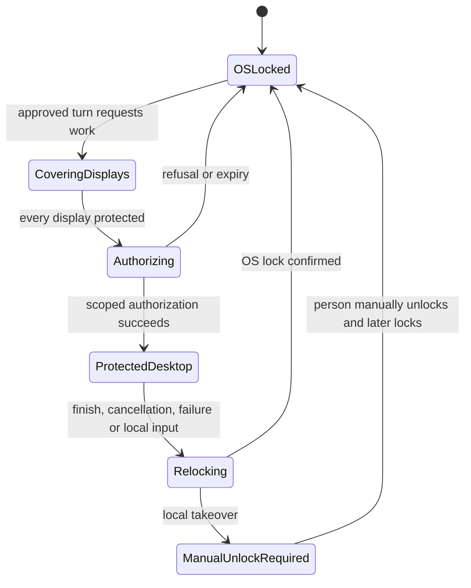

# Codex and ChatGPT locked computer use

> **Status 2026-10-26.** ace now implements an opt-in locked computer use component:
> authorization plug-in, session driver, independent relock guardian, root broker,
> GUI-session service, and install/removal, all failing closed. Whether requesting
> `system.login.screensaver` actually unlocks a logged-in locked session is still open; it
> can only be settled by installing the component on a real Mac and testing it. See the
> [ADR 0087 amendment](../adr/0087-background-computer-use-engine.md#amendment-2026-10-26-locked-computer-use).
> No authorization policy was changed to write these docs.

Investigated 2026-10-23 on macOS 26.2. This is a clean-room behavioral and interface
investigation, not an implementation extracted from OpenAI's software. No proprietary
implementation source or disassembly was read. No authorization policy, plug-in installation,
credentials or Locked Use settings were changed. Native-app inspection opened app UIs in the
background; no competitor task was submitted.

## Finding

OpenAI documents an opt-in authorization plug-in, temporary desktop unlocking for a trusted
active turn, display covers and relocking on local input. After a takeover, automatic unlock
stays paused until manual unlock. This is the missing architectural difference from ace's
attempt to drive native controls while the OS desktop remains locked.
Sources: [Computer Use](https://learn.chatgpt.com/docs/computer-use),
[local security](https://learn.chatgpt.com/docs/enterprise/chatgpt-work-local-security).

The ace lock probe's invalid accessibility references are consistent with this distinction.
That probe establishes a limitation of the current AX-only route, not that a consented
Authorization Services design is impossible. The keep-awake fix remains necessary but cannot
supply authorization or local-input protection.

## Local evidence

Read-only inspection of this machine established the following. These are observations of
installed artifacts, not promises about all versions of the product.

| Artifact                                                                            | Observed interface or metadata                                                                                        |
| ----------------------------------------------------------------------------------- | --------------------------------------------------------------------------------------------------------------------- |
| `/Applications/ChatGPT.app`                                                         | Bundle ID `com.openai.codex`, version `26.1013.40934`, build `20770`                                                  |
| Nested `Codex Computer Use.app`                                                     | Bundle ID `com.openai.sky.CUAService`, executable `SkyComputerUseService`                                             |
| Nested `Codex Computer Use Installer.app`                                           | Separate installer bundle ID ending in `AuthorizationPluginInstaller`                                                 |
| Installer's authorization bundle                                                    | `CodexComputerUseAuthorizationPlugin.bundle`, bundle ID `com.openai.sky.CUAService.AuthorizationPlugin`               |
| `/Library/Security/SecurityAgentPlugins/CodexComputerUseAuthorizationPlugin.bundle` | Already installed, root-owned, mode `0755`, version `0.1.0`, build `857`                                              |
| Bundled authorization plug-in                                                       | Version `26.1013.1001501`, build `1001501`; it differs from the installed copy                                        |
| Installed plug-in exported entry point                                              | `AuthorizationPluginCreate`                                                                                           |
| `system.login.screensaver` authorization rule                                       | `k-of-n = 1`; alternatives reference `com.openai.sky.CUAService.AuthorizationPlugin.remote` and `use-login-window-ui` |
| Remote authorization rule                                                           | `evaluate-mechanisms`, mechanism `CodexComputerUseAuthorizationPlugin:allow`                                          |

The installed remote rule's description says it asks the computer-use client about a pending
active-turn authorization. That is evidence of the registered integration contract, not proof
that the implementation validates every IPC peer or failure condition correctly. The rule's
Apple signing requirement must not be mistaken for proof of the separate service's peer
validation.

Code-signing metadata identifies the inspected bundled components with OpenAI's Developer ID
team. The helper's imported interfaces include Security code-identity APIs, audit-token APIs,
IOKit power assertions and the Quartz session query. These are consistent with identity checks
and power/session management, but imports alone do not establish their use or sequencing.
The installer imports `AuthorizationExecuteWithPrivileges`; the local Apple SDK marks that API
deprecated. Neither imports nor ordinary Developer ID signatures demonstrate that every part
uses current public APIs or has specific Apple approval.

Reproduction uses metadata/interface tools only:

- Parse each bundle's `Contents/Info.plist` with `plistlib`.
- Inspect signatures and entitlement declarations with `codesign -d`.
- List linked libraries with `otool -L` and imported/exported interface symbols with `nm`.
- Read the two named rights using `security authorizationdb read`.

No `authorizationdb write`, installer execution, Keychain reads or security-setting mutations
were performed. Those are outside this investigation.

## What Apple documents

Apple documents authorization plug-ins as an extension point: the authorization engine calls
`AuthorizationPluginCreate` and the mechanism lifecycle, and the plug-in reports its decision
through `SetResult`. Registration includes an installed bundle and an authorization rule.
This supports the observed architecture, but does not establish a complete supported API
sequence for triggering temporary screen unlock.
Source: [Extending authorization services with plug-ins](https://developer.apple.com/documentation/security/extending-authorization-services-with-plug-ins).

Apple also warns that some authorization-policy tag definitions are not public API. Keep
claims about a public plug-in interface separate from claims about the complete lock/unlock
implementation. The companion [Apple API investigation](macos-authorization-plugin-locked-use.md)
covers these boundaries.

## Clean-room design implications for ace

The following are proposed requirements, not a description of OpenAI's internal protocol.
They need an explicit design review before privileged installation or policy changes.

1. Add a separate user-enabled Locked Use capability. Installing an authorization mechanism
   changes the machine's security policy; ordinary Accessibility permission is insufficient.
2. Tie each authorization request to the exact approved thread, active turn, GUI session and
   short deadline. Authenticate the requesting process; never expose a general unlock API to
   arbitrary local clients or model-generated shell commands.
3. Require verified coverage of all displays before any temporary unlock. Handle displays
   being attached, removed, mirrored or reconfigured throughout the protected interval.
4. Detect local human input independently of agent-posted events. Relock and pause on human
   input. A model/tool request must not clear the manual-takeover latch.
5. Treat cover failure, IPC loss, process exit, cancellation, stale authorization and sleep/wake
   as explicit state-machine transitions. Define which trusted process can enforce relock when
   the UI helper dies; a best-effort panel is not enough.
6. Preserve the normal manual-unlock route. Design installation, update, disablement and removal
   to coexist with other installed authorization providers rather than overwrite their policy.
7. Reuse the current AX, capture and background-input engine only inside a validated protected
   desktop interval. Keep ordinary locked-mode refusal outside that interval.

A conceptual state sequence is:

The exact supported unlock trigger, authorization transport, display-cover implementation,
input interception and crash-relock enforcement remain unverified. They must be resolved in a
controlled prototype; the existence of a plug-in does not by itself make a secure implementation.
