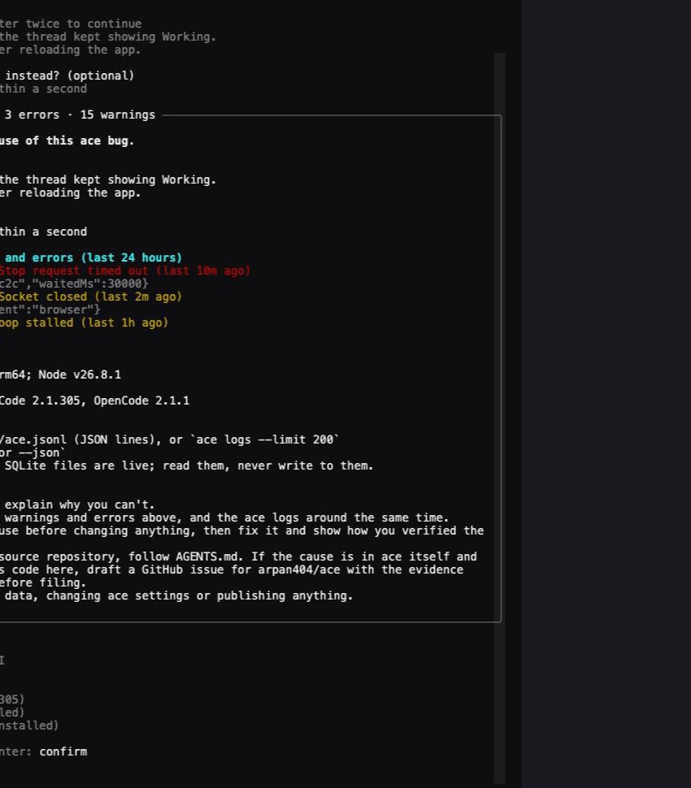
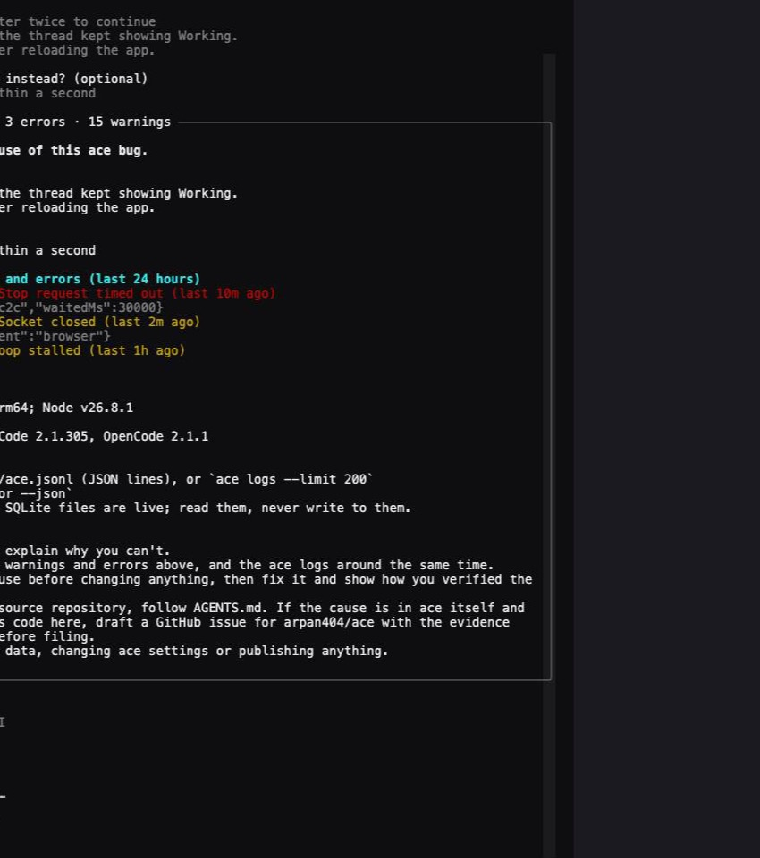

# CLI triage verification

Triage is CLI-only. The screenshots show the real `ace triage` process in a PTY with
a temporary ACE_HOME holding a few sample log lines, rendered with xterm.js. `claude`
and `opencode` are local stubs that print a version; Codex and Cursor are absent. No
provider session was launched.

The preview colours section headings, errors and warnings, and its title counts the
lines, errors and warnings attached. Uninstalled CLIs stay visible but disabled.

Process tests use temporary homes and local stub executables. They cover literal
prompt arguments for Cursor (`--` then the prompt) and OpenCode (`--prompt=`), the
picker offering only installed CLIs, Ctrl-C reaching the agent while ace waits for its
exit code, cancellation before anything is generated, real log lines grouped into the
prompt with secrets redacted and the log file untouched, prompt generation without a
daemon, folder repairs that preserve data, and refusal of linked targets.

Database tests exercise real SQLite files. Doctor detects deleted-row free pages and
reclaims over 2 MiB through the running daemon while preserving surviving row IDs and
payloads, even when a remote CLI profile is selected. Legacy databases retain
reusable pages and row IDs. Offline and corrupt files remain byte-identical after `doctor --fix`. A pinned reader keeps its WAL and
snapshot; after it closes, a second repair truncates the WAL without losing rows.
Existing storage tests also cover write fencing, interrupted compaction recovery, pending work and legacy row IDs.
