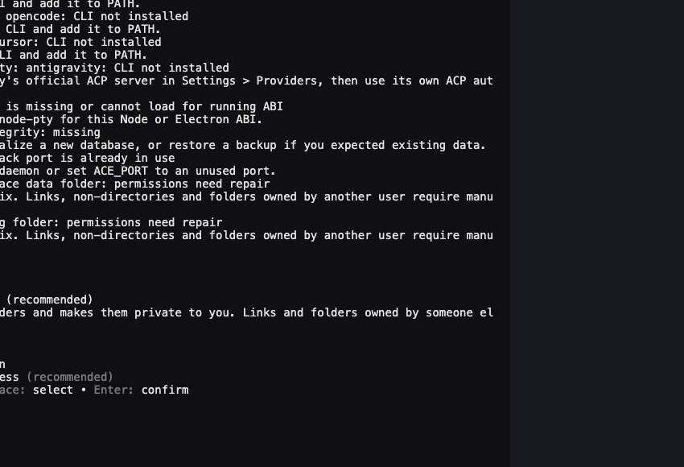

# CLI triage verification

Triage and doctor are CLI-only. The screenshots show the real `ace triage` and
`ace doctor` processes in a PTY with a temporary ACE_HOME, rendered with xterm.js.
`claude` and `opencode` are local stubs that print a version; no provider session was
launched.

Unit tests cover the facts file (versions, paths, never-open files, grouped recent
errors, failed probes, doctor findings), the one-line launch, the log digest, and the
repair plan: no repairs when healthy, folder and space repairs recommended while ace
runs, space reclaim blocked when it doesn't, and no compaction for a database that
fails its integrity check.

Process tests use temporary homes and local stub executables. They cover the agent
starting in the triage folder with one line naming the playbook, which names the facts
file; Cursor getting `--` then the line and OpenCode getting `--prompt=`; the picker
offering only installed agents; Ctrl-C reaching the agent while ace waits for its exit
code; Ctrl-C at the picker launching nothing; real log lines grouped into the facts
with secrets redacted and the ace folder untouched; triage still writing its files
with invalid settings and an unreadable log; doctor listing repairs without changing
anything unless asked; folder repairs that preserve data; and refusal of linked
targets.

Database tests exercise real SQLite files. Doctor detects deleted-row free pages and
reclaims over 2 MiB through the running daemon while preserving surviving row IDs and
payloads, even when a remote CLI profile is selected. Legacy databases retain
reusable pages and row IDs. Offline and corrupt files remain byte-identical after `doctor --fix`. A pinned reader keeps its WAL and
snapshot; after it closes, a second repair truncates the WAL without losing rows.
Existing storage tests also cover write fencing, interrupted compaction recovery, pending work and legacy row IDs.
